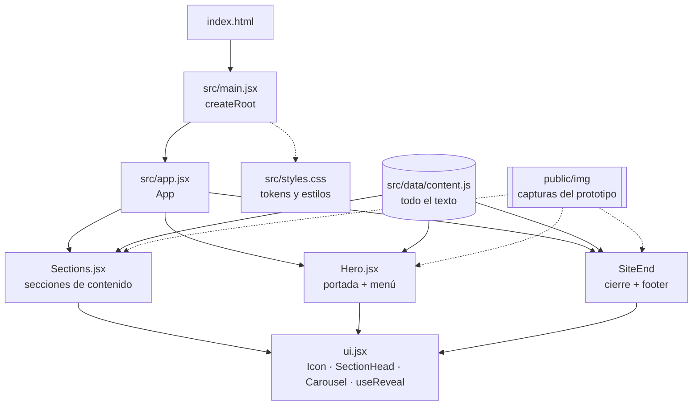
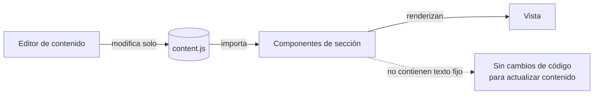
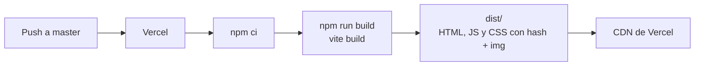

# Insulin·VR · Landing del prototipo educativo inmersivo


Página de presentación de **Insulin·VR**, un prototipo educativo inmersivo para aprender la técnica de insulinización con el teléfono del paciente y un visor tipo Google Cardboard. La landing acompaña el proyecto de grado del programa de Ingeniería de Sistemas de la Universidad Autónoma de Bucaramanga (UNAB) y se usa para presentar el avance en IngenioTIC 2026.

---

## Contenido

- [Descripción](#descripción)
- [Stack](#stack)
- [Arquitectura](#arquitectura)
- [Estructura del repositorio](#estructura-del-repositorio)
- [Puesta en marcha](#puesta-en-marcha)
- [Cómo editar el contenido](#cómo-editar-el-contenido)
- [Sistema de diseño](#sistema-de-diseño)
- [Despliegue](#despliegue)
- [Pendientes](#pendientes)
- [Equipo y créditos](#equipo-y-créditos)

## Descripción

La página cuenta el proyecto en orden: el problema clínico, la justificación, los objetivos, la metodología y el prototipo construido. Luego muestra los resultados, el cronograma y el equipo.

El prototipo que presenta tiene:

| Elemento | Cantidad |
|---|---|
| Módulos de enseñanza | 5 |
| Pasos narrados con subtítulos | 60 |
| Exámenes (uno por módulo) | 5 |
| Puntos de teletransporte | 13 |

Los resultados de la validación con expertos (SUS, IVC y Likert) y el rendimiento en otros dispositivos aparecen como **pendientes** hasta que se obtengan los datos.

## Stack

| Capa | Tecnología |
|---|---|
| Interfaz | React 18.3 (componentes funcionales y hooks) |
| Build y servidor de desarrollo | Vite 5.4 con `@vitejs/plugin-react` |
| Estilos | CSS propio con variables (tokens) en `src/styles.css` |
| Tipografía | Inter Tight (Google Fonts) |
| Íconos | SVG en línea (`Icon` en `src/components/ui.jsx`) |
| Hosting | Vercel (configurado en `vercel.json`) |

No usa librerías de UI ni de animación: las animaciones de entrada usan `IntersectionObserver` y transiciones CSS.

## Arquitectura

### Componentes



### Orden de la página

```mermaid
flowchart LR
    A["Hero"] --> B["Problema"] --> C["Justificación"] --> D["Pregunta"] --> E["Objetivos"]
    E --> F["Metodología"] --> G["Referentes"] --> H["Prototipo"] --> I["Módulos"]
    I --> J["Tecnología"] --> K["Normas"] --> L["Resultados"] --> M["Cronograma"]
    M --> N["Equipo"] --> O["Preguntas frecuentes"] --> P["Cierre + footer"]
```



### Flujo de datos



`src/data/content.js` es la única fuente del texto de la página. Los componentes solo definen la estructura y el estilo, así que para actualizar cifras, fechas o resultados basta con editar ese archivo.

### Build y despliegue



## Estructura del repositorio

```
vr-landing-page/
├── index.html              # Documento base, metadatos y fuente
├── vite.config.js          # Configuración de Vite con el plugin de React
├── vercel.json             # Build y salida para Vercel
├── package.json
├── public/
│   └── img/                # Capturas reales del prototipo (Unity)
└── src/
    ├── main.jsx            # Punto de entrada: monta <App /> y carga los estilos
    ├── app.jsx             # Composición y orden de las secciones
    ├── styles.css          # Tokens de diseño, componentes y responsive
    ├── assets/
    │   └── problema/       # Fotos WebP de la sección «El problema» (Unsplash)
    ├── data/
    │   └── content.js      # Texto, cifras, fechas y enlaces de la página
    └── components/
        ├── Hero.jsx        # Portada con menú flotante, título y cifras
        ├── Sections.jsx    # Secciones de contenido, cierre y footer
        └── ui.jsx          # Íconos, encabezado de sección, carrusel y animación de entrada
```

## Puesta en marcha

Requisitos: Node.js 18 o superior y npm.

```bash
npm install        # instalar dependencias
npm run dev        # servidor de desarrollo en http://localhost:5173
npm run build      # build de producción en dist/
npm run preview    # servir el build localmente
```

## Cómo editar el contenido

Todo el texto está en `src/data/content.js`. Algunos ejemplos:

- **Cifras de la portada:** `hero.stats`.
- **Resultados de la validación:** `results.validation.items` (instrumento, qué mide y meta). Por ahora el componente `Results` de `Sections.jsx` muestra «Pendiente» fijo; cuando haya datos, agrega el valor a cada ítem y muéstralo en lugar de ese texto.
- **Rendimiento en otros dispositivos:** `results.performance.pending`.
- **Cronograma:** `timeline.phases`, con el estado de cada actividad (`Hecho`, `En curso` o una fecha).
- **Preguntas frecuentes:** `faq`.
- **Enlaces del footer:** `footer.columns`. La columna «Enlaces» reutiliza `nav`.

Para **reordenar o quitar secciones**, edita la lista dentro de `<main>` en `src/app.jsx`. El fondo alterno (blanco y gris claro) se calcula solo con `nth-last-child`, así que no hace falta ajustar estilos al moverlas.

Las imágenes nuevas van en `public/img/` y se referencian como `/img/nombre.jpg`.

## Sistema de diseño

Inspirado en la plantilla «Healthcare Clinic Platform»: estilo clínico claro, títulos grandes y fotos a sangre.

| Token | Uso |
|---|---|
| `--bg`, `--bg-soft`, `--surface` | Fondos de página, secciones alternas y tarjetas |
| `--ink`, `--ink-2`, `--muted`, `--line` | Texto principal, secundario, atenuado y líneas |
| `--accent`, `--accent-soft` | Azul grisáceo de acentos y beige de etiquetas |
| `--frame` | Margen exterior de la portada y del cierre (12 px; 6 px en móvil) |
| `--gutter` | Relleno interno adaptable (16 a 48 px) |
| `--edge` | `--frame + --gutter`: borde del contenido en toda la página |
| `--r-sm`, `--r`, `--r-lg`, `--pill` | Radios de esquinas y botones en píldora |

- **Breakpoints:** 1024 px, 860 px (menú hamburguesa y columnas apiladas) y 560 px.
- **Accesibilidad:**
  - Respeta `prefers-reduced-motion`.
  - El acordeón y el menú usan `aria-expanded`.
  - Los botones del carrusel llevan `aria-label` y las imágenes con contenido tienen texto alternativo.
  - Los resultados se indican con texto además de color.

## Despliegue

`vercel.json` define el despliegue:

```json
{
  "framework": "vite",
  "installCommand": "npm ci",
  "buildCommand": "npm run build",
  "outputDirectory": "dist"
}
```

Cada push a `master` genera un despliegue de producción en Vercel.

## Pendientes

- [ ] Resultados de SUS, IVC y Likert tras la prueba en vivo con médicos del 21 de octubre de 2026.
- [ ] Rendimiento del prototipo en otros dispositivos Android.
- [ ] Video del recorrido por el prototipo.

## Equipo y créditos

| Rol | Nombre |
|---|---|
| Líder de desarrollo | Brayan Steven León Martínez |
| Contenido 3D, audio y documentación | Santiago Cardona Prada |
| Director | Leonardo Stiven Pardo Niño |
| Asesoría temática | Dra. Ana María Ospina Galeano y Dr. Jaime Gómez, médicos internistas de la Fundación Clínica |

Proyecto de grado · Ingeniería de Sistemas · Universidad Autónoma de Bucaramanga (UNAB) · 2026.

Referencia de diseño: «Healthcare Clinic Platform», de Shuvo, publicado en Dribbble.

Fotografías de la sección «El problema» (`src/assets/problema/`, convertidas a WebP), tomadas de [Unsplash](https://unsplash.com/license) con licencia gratuita:

| Archivo | Foto | Autor |
|---|---|---|
| `via.webp` | [Hombre inyectando insulina en el muslo](https://unsplash.com/photos/UM90Wz08pJE) | Sweet Life |
| `rotacion.webp` | [Persona que se inyecta insulina en el estómago](https://unsplash.com/photos/Q2WEVTw6wyw) | Sweet Life |
| `almacenamiento.webp` | [Frigorífico de puertas francesas](https://unsplash.com/photos/FDQFZHY9iG4) | nrd |
| `ansiedad.webp` | [Mujer con la cabeza entre las manos](https://unsplash.com/photos/WI4k8Z15hbQ) | engin akyurt |
