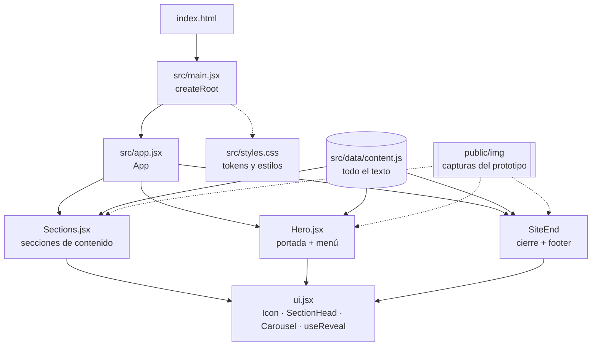
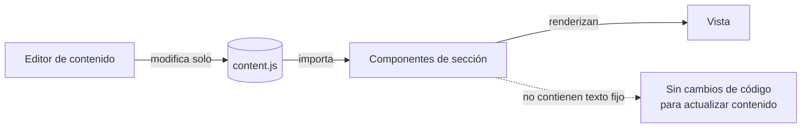
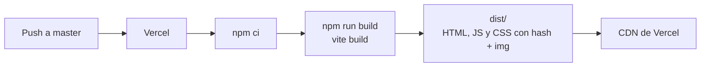

# Insulin·VR · Landing del prototipo educativo inmersivo


Página de presentación de **Insulin·VR**, un prototipo educativo inmersivo para aprender la técnica de insulinización con el teléfono del paciente y un visor tipo Google Cardboard. La landing acompaña el proyecto de grado del programa de Ingeniería de Sistemas de la Universidad Autónoma de Bucaramanga (UNAB) y se usa para presentar el avance en IngenioTIC 2026.

---

## Contenido

- [Descripción](#descripción)
- [Stack](#stack)
- [Arquitectura](#arquitectura)
- [Estructura del repositorio](#estructura-del-repositorio)
- [Puesta en marcha](#puesta-en-marcha)
- [Cómo editar el contenido](#cómo-editar-el-contenido)
- [Sistema de diseño](#sistema-de-diseño)
- [Despliegue](#despliegue)
- [Pendientes](#pendientes)
- [Equipo y créditos](#equipo-y-créditos)

## Descripción

La página cuenta el proyecto en orden: el problema clínico, la justificación, los objetivos, la metodología y el prototipo construido. Luego muestra los resultados y el equipo.

El prototipo que presenta tiene:

| Elemento | Cantidad |
|---|---|
| Módulos de enseñanza | 5 |
| Partes por módulo, con barra de partes | 5 |
| Preguntas del examen general | 10 |
| Puntos de teletransporte | 17 |

La página está escrita como presentación final del proyecto. Los valores de las pruebas internas de caja blanca, de la valoración con dos médicos (SUS e IVC) y del rendimiento por dispositivo se muestran con «—» y la etiqueta «Pendiente» hasta cargarlos en `content.js`.

## Stack

| Capa | Tecnología |
|---|---|
| Interfaz | React 18.3 (componentes funcionales y hooks) |
| Build y servidor de desarrollo | Vite 5.4 con `@vitejs/plugin-react` |
| Estilos | CSS propio con variables (tokens) en `src/styles.css` |
| Tipografía | Inter Tight (Google Fonts) |
| Íconos | SVG en línea (`Icon` en `src/components/ui.jsx`) |
| 3D | Three.js 0.179 (`FBXLoader`), cargado bajo demanda en `src/components/PenModel.jsx` |
| Hosting | Vercel (configurado en `vercel.json`) |

No usa librerías de UI ni de animación: las animaciones de entrada usan `IntersectionObserver` y transiciones CSS.

## Arquitectura

### Componentes



### Orden de la página

```mermaid
flowchart LR
    A["Hero"] --> B["Problema y cifras"] --> C["Justificación"] --> D["Pregunta"] --> E["Objetivos"]
    E --> F["Metodología"] --> G["Arquitectura"] --> H["Prototipo"] --> I["Módulos"]
    I --> J["Tecnología"] --> L["Resultados"]
    L --> N["Equipo"] --> O["Preguntas frecuentes"] --> P["Cierre + footer"]
```



### Flujo de datos



`src/data/content.js` es la única fuente del texto de la página. Los componentes solo definen la estructura y el estilo, así que para actualizar cifras, fechas o resultados basta con editar ese archivo.

### Build y despliegue



## Estructura del repositorio

```
vr-landing-page/
├── index.html              # Documento base, metadatos y fuente
├── vite.config.js          # Configuración de Vite con el plugin de React
├── vercel.json             # Build y salida para Vercel
├── package.json
├── public/
│   ├── img/                # Capturas reales del prototipo (Unity)
│   └── models/             # Lapicero 3D propio del proyecto (FBX exportado desde Unity)
└── src/
    ├── main.jsx            # Punto de entrada: monta <App /> y carga los estilos
    ├── app.jsx             # Composición y orden de las secciones
    ├── styles.css          # Tokens de diseño, componentes y responsive
    ├── assets/
    │   ├── problema/       # Fotos WebP de la sección «El problema» (Unsplash)
    │   ├── pregunta/       # Fondo WebP de la pregunta problema, escritorio y móvil (Unsplash)
    │   ├── objetivos/      # Fotos WebP de los objetivos específicos (Unsplash)
    │   ├── metodologia/    # Fotos WebP de las fases PMBOK (Unsplash)
    │   └── equipo/         # Fotos WebP del equipo (aportadas por el equipo)
    ├── data/
    │   └── content.js      # Texto, cifras, fechas y enlaces de la página
    └── components/
        ├── Hero.jsx        # Portada con menú flotante, título y cifras
        ├── Sections.jsx    # Secciones de contenido, cierre y footer
        └── ui.jsx          # Íconos, encabezado de sección, carrusel y animación de entrada
```

## Puesta en marcha

Requisitos: Node.js 18 o superior y npm.

```bash
npm install        # instalar dependencias
npm run dev        # servidor de desarrollo en http://localhost:5173
npm run build      # build de producción en dist/
npm run preview    # servir el build localmente
```

## Cómo editar el contenido

Todo el texto está en `src/data/content.js`. Algunos ejemplos:

- **Cifras de la portada:** `hero.stats`.
- **Cifras del problema:** `stats`, con `value`, `label`, `source` y `url` de la fuente (todas tomadas del documento del proyecto).
- **Pruebas de caja blanca:** `results.whitebox.items`. Cada ítem tiene `value`, que reemplaza el «—», y su umbral de aceptación `target` (propuesto por el equipo, sin confirmar).
- **Valoración con dos médicos:** `results.validation.items` (SUS e IVC, descriptivo con n = 2), con `value` y su referencia `goal`, y `results.validation.improvements` para las mejoras recomendadas.
- **Rendimiento por dispositivo:** `results.performance.devices`, con `name`, `avg` (FPS medio) y `min` (FPS mínimo).
- **Preguntas frecuentes:** `faq`.
- **Enlaces del footer:** `footer.columns`. La columna «Enlaces» reutiliza `nav`.

Para **reordenar o quitar secciones**, edita la lista dentro de `<main>` en `src/app.jsx`. Todas las secciones tienen fondo blanco; el color va en las tarjetas, así que se pueden mover sin ajustar estilos.

Las imágenes nuevas van en `public/img/` y se referencian como `/img/nombre.jpg`.

## Sistema de diseño

Inspirado en la plantilla «Healthcare Clinic Platform»: estilo clínico claro, títulos grandes y fotos a sangre.

| Token | Uso |
|---|---|
| `--bg`, `--surface` | Fondo blanco de la página y gris claro de las tarjetas |
| `--ink`, `--ink-2`, `--muted`, `--line` | Texto principal, secundario, atenuado y líneas |
| `--accent`, `--accent-soft` | Azul grisáceo de acentos y beige de etiquetas |
| `--frame` | Parte fija del margen lateral del contenido (12 px; 6 px en móvil). Portada, pregunta, cierre y footer van a todo el ancho, sin margen |
| `--gutter` | Relleno interno adaptable (16 a 48 px) |
| `--edge` | `--frame + --gutter`: borde del contenido en toda la página |
| `--r-sm`, `--r`, `--r-lg`, `--pill` | Radios de esquinas y botones en píldora |

- **Breakpoints:** 1024 px, 860 px (menú hamburguesa y columnas apiladas) y 560 px.
- **Accesibilidad:**
  - Respeta `prefers-reduced-motion`.
  - El acordeón y el menú usan `aria-expanded`.
  - Los botones del carrusel llevan `aria-label` y las imágenes con contenido tienen texto alternativo.
  - Los resultados se indican con texto además de color.

## Despliegue

`vercel.json` define el despliegue:

```json
{
  "framework": "vite",
  "installCommand": "npm ci",
  "buildCommand": "npm run build",
  "outputDirectory": "dist"
}
```

Cada push a `master` genera un despliegue de producción en Vercel.

## Pendientes

- [ ] Resultados de las pruebas internas de caja blanca y de SUS e IVC con los dos médicos, tras la prueba en vivo del 21 de octubre de 2026.
- [ ] Rendimiento del prototipo en otros dispositivos Android.
- [ ] Video del recorrido por el prototipo.

## Equipo y créditos

| Rol | Nombre |
|---|---|
| Líder de desarrollo | Brayan Steven León Martinez |
| Contenido 3D, audio y documentación | Santiago Cardona Prada |
| Director | Leonardo Stiven Pardo Niño |
| Asesoría temática | Dra. Ana María Ospina Galeano y Dr. Jaime Gómez, médicos internistas de la Fundación Clínica |

Proyecto de grado · Ingeniería de Sistemas · Universidad Autónoma de Bucaramanga (UNAB) · 2026.

Referencia de diseño: «Healthcare Clinic Platform», de Shuvo, publicado en Dribbble.

Portada (`public/img/cocina_portada.webp`): render de la cocina del prototipo, generado en Unity por el equipo.

Sala de estar y sala de estudio (`public/img/sala_estar.webp`, `public/img/sala_estudio.webp`): renders del prototipo, generados en Unity por el equipo.

Fotografías de «El problema» (`src/assets/problema/`), la pregunta problema (`src/assets/pregunta/`) los objetivos (`src/assets/objetivos/`) y la metodología (`src/assets/metodologia/`), convertidas a WebP, tomadas de [Unsplash](https://unsplash.com/license) con licencia gratuita:

| Archivo | Foto | Autor |
|---|---|---|
| `via.webp` | [Hombre inyectando insulina en el muslo](https://unsplash.com/photos/UM90Wz08pJE) | Sweet Life |
| `rotacion.webp` | [Persona que se inyecta insulina en el estómago](https://unsplash.com/photos/Q2WEVTw6wyw) | Sweet Life |
| `almacenamiento.webp` | [Frigorífico de puertas francesas](https://unsplash.com/photos/FDQFZHY9iG4) | nrd |
| `ansiedad.webp` | [Mujer con la cabeza entre las manos](https://unsplash.com/photos/WI4k8Z15hbQ) | engin akyurt |
| `pregunta/cardboard.webp` (y `cardboard-mobile.webp`) | [Lost In Reality, mujer con visor Google Cardboard](https://unsplash.com/photos/VZN-f2gsvb4) | Matthew Kwong |
| `objetivos/requerimientos.webp` | [Médico consultando con un paciente en un consultorio](https://unsplash.com/photos/MJmsLpeHPfg) | Vitaly Gariev |
| `objetivos/diseno.webp` | [Persona dibujando un wireframe en papel](https://unsplash.com/photos/v9FQR4tbIq8) | Kelly Sikkema |
| `objetivos/validacion.webp` | [Profesionales de la salud revisando una tableta](https://unsplash.com/photos/DbCfSrTnflA) | Nappy |
| `metodologia/inicio.webp` | [Personas colaborando en el plan del proyecto](https://unsplash.com/photos/v89zhr0iBFY) | airfocus |
| `metodologia/planificacion.webp` | [Calendario con chinchetas rojas](https://unsplash.com/photos/bwOAixLG0uc) | Towfiqu barbhuiya |
| `metodologia/ejecucion.webp` | [Portátil con código de programación](https://unsplash.com/photos/f77Bh3inUpE) | Arnold Francisca |
| `metodologia/monitoreo.webp` | [Post-its para gestión de proyectos](https://unsplash.com/photos/OXmym9cuaEY) | Eden Constantino |
| `metodologia/cierre.webp` | [Profesional presentando frente a una pantalla](https://unsplash.com/photos/xoCrMyMFt7s) | ThisisEngineering |
